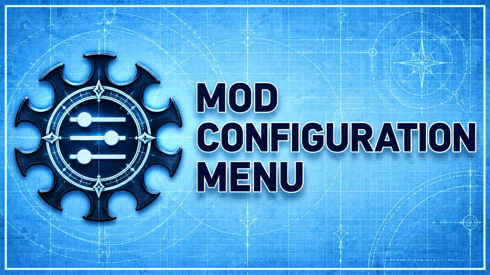

# Mod Configuration Menu

Volitio's Mod Configuration Menu, built from its GitHub source: the in-game menu for the settings and hotkeys of other mods.

## What it does

The **Mod Configuration Menu (MCM)** by **Volitio** gives Baldur's Gate 3 one in-game menu for the settings and
hotkeys of all mods that use it. No more editing of JSON files:

- Settings and hotkeys of many mods in one window, with search and conflict checks for hotkeys.
- Changes apply at once, without loading the save again.
- Settings are saved in files outside the savegames, in profiles.
- Mods can show their texts in your language when they have translations.
- In this build, the sidebar with the list of mods is always shown: it never collapses or hides.
- The window title ends with "(KintaroModding)", so you can tell this build from the official one.

## Screenshots

## Why this build

The author publishes MCM on [Nexus Mods](https://www.nexusmods.com/baldursgate3/mods/9162) and its source code on
[GitHub](https://github.com/AtilioA/BG3-MCM), but the GitHub repository has no releases. This fork builds releases
from that source, so that the download and the source match, and so that the mod stays maintainable in any case.
It is the same mod, with the same UUID, so every mod that uses MCM works with it. It has two small changes: the
sidebar with the list of mods is always shown (the settings to hide or toggle it are gone), and the window title
names this build. Details are in [FORK.md](FORK.md).

This release is version 1.41.0.2: upstream version 1.41.0.0 (commit `4d8a05c`, 2026-03-21) with these changes.

## How to install

1. Install [Norbyte's Script Extender](https://github.com/Norbyte/bg3se). It updates itself.
2. If you have the official MCM installed, delete its `.pak` first. Only one copy may be installed: two files with
   the same UUID conflict.
3. Download `bg3_mcm.pak` from the latest release on GitHub.
4. Copy it to `%LOCALAPPDATA%\Larian Studios\Baldur's Gate 3\Mods`.
5. Enable **Mod Configuration Menu** in your mod manager (BG3 Mod Manager or the in-game mod manager), at the top of
   the load order, before the mods that use it.

To update, replace the `.pak` with the one from the new release. Your settings stay: they are in
`%LOCALAPPDATA%\Larian Studios\Baldur's Gate 3\Script Extender\BG3MCM`.

## How to use

Open the menu from the main menu or the Esc menu, or press **Insert** (you can change this key). Select a mod on the
left and change its settings.

## Compatibility

- Game version: Patch 8
- Works with every mod that uses MCM, because it keeps the UUID, the folder and the interface of the official MCM.
- Do not install it next to the official MCM.

## Known issues

- MCM's one-time welcome note still says that the gamepad Back button opens the sidebar. In this build the sidebar
  is always open.

For problems with MCM itself, see the [upstream issues](https://github.com/AtilioA/BG3-MCM/issues).

## How to build

Anyone can build this mod from its source code and check that the download matches it.

1. Install the tools: Windows PowerShell 5.1 (part of Windows) and [LSLib](https://github.com/Norbyte/lslib/releases)
   v1.20.4. Put LSLib into a folder `_tools\lslib\` above the repository, or set `BG3_TOOLS` to the folder that holds
   `lslib\`.
2. Build it: `powershell -ExecutionPolicy Bypass -File .\build.ps1`. The script converts the texts
   (`Localization\*\*.loca.xml` to `.loca`) and packs the folder `Mod Configuration Menu`.
3. Find the file: `output\bg3_mcm.pak`

## Credits

- **Mod Configuration Menu** by **Volitio** (AtilioA): all of the mod.
  [GitHub](https://github.com/AtilioA/BG3-MCM), [Nexus Mods](https://www.nexusmods.com/baldursgate3/mods/9162),
  [Patreon](https://patreon.com/volitio).
- Fonts Inter (The Inter Project Authors) and OpenDyslexic (Abbie Gonzalez), SIL Open Font License 1.1.
- reactivex (Bjorn Swenson, Paweł Kierzkowski), MIT license.
- This build and its releases: Kintaro.

License: GNU Affero General Public License v3.0, as the original. You may use, change and share it under the same
license; the source code is in this repository.
